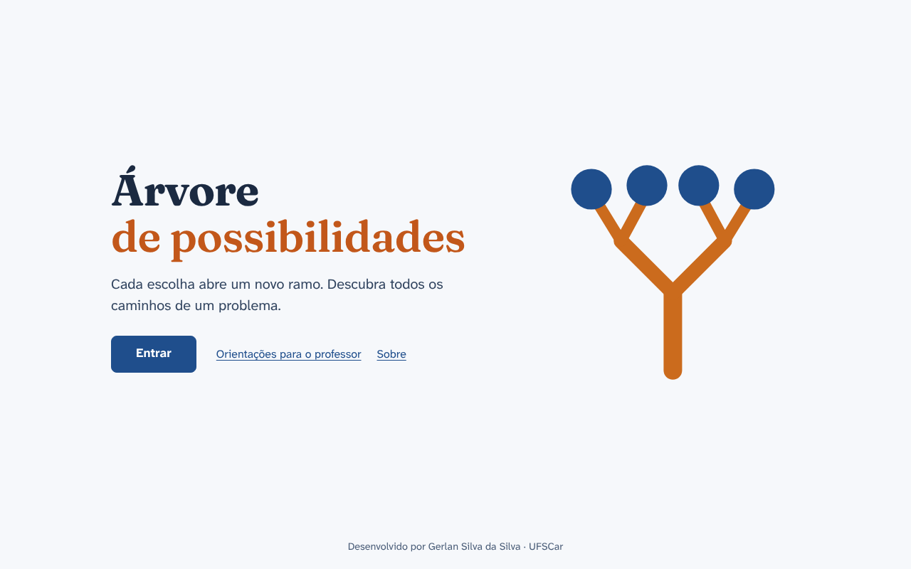
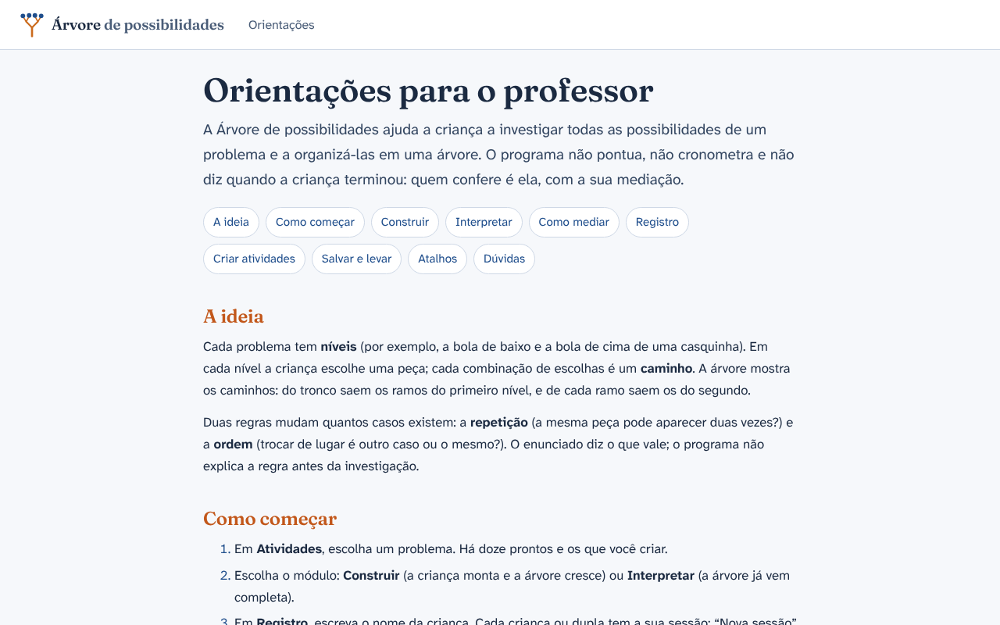
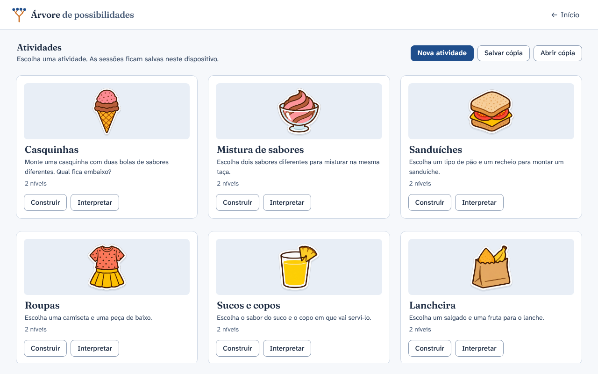
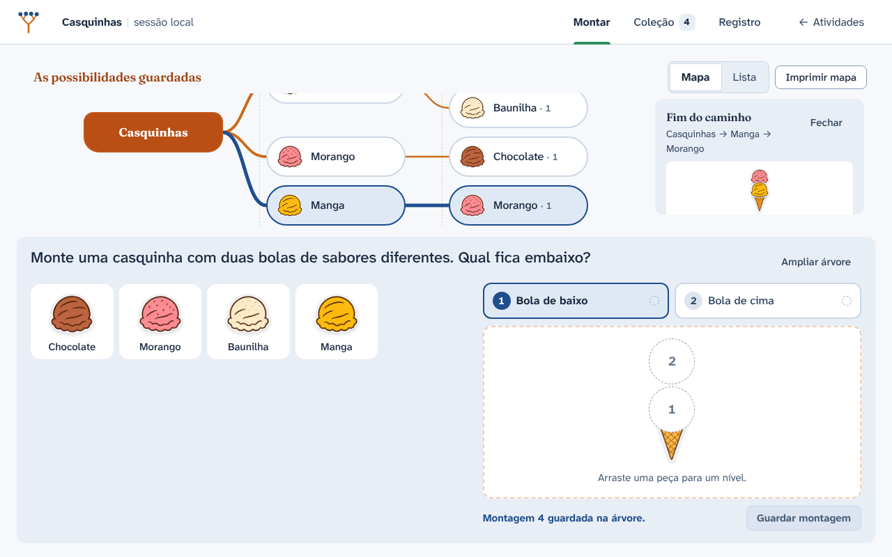
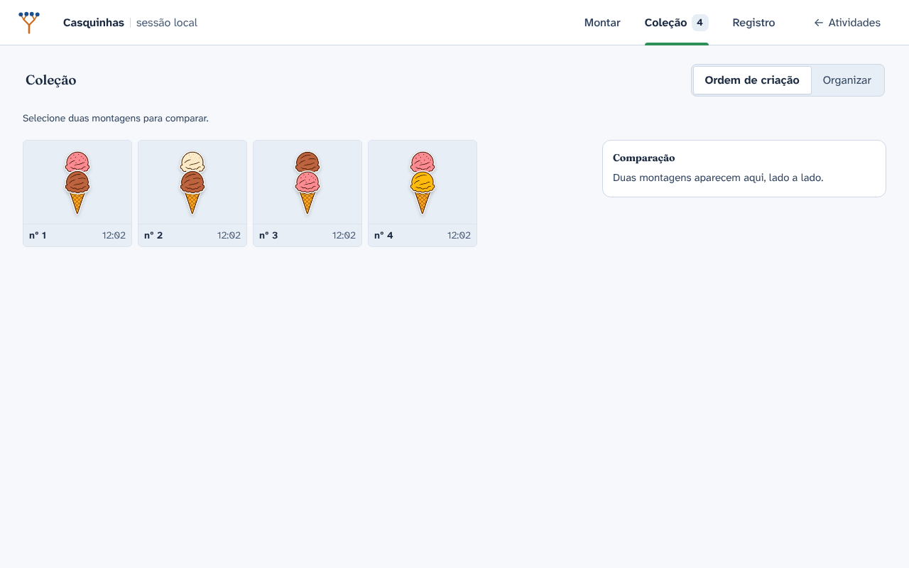
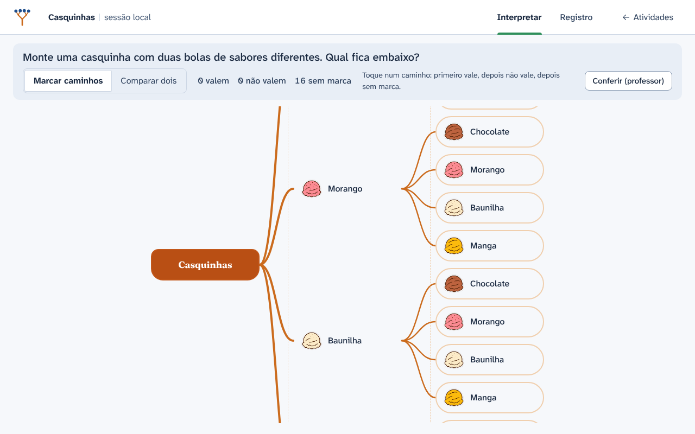
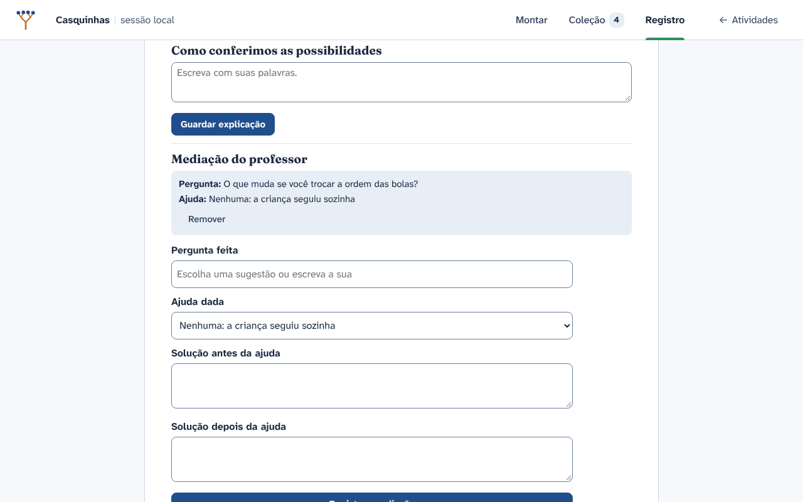
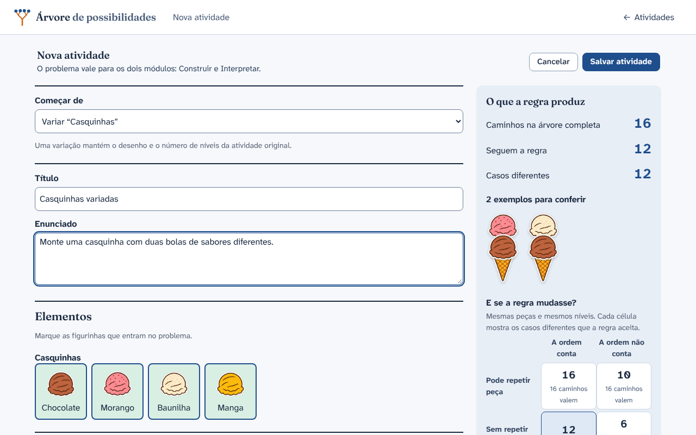

# Árvore de possibilidades

Programa educativo de **combinatória para os anos iniciais**, inspirado nos *Diagramas de Árbol* mexicanos (Aguirre, 2005) e no Árbol documentado por Azevedo, Costa e Borba (2011). A criança **investiga** as possibilidades de um problema e vê a árvore aparecer; o professor acompanha e media. Não há pontuação, cronômetro, ranking nem telemetria: é um ambiente de investigação, não um jogo.

Aplicativo de mesa (Tauri 2 + React 19 + TypeScript) para **macOS** e **Windows**. Tudo funciona sem internet e os dados ficam no próprio computador.



Na tela inicial há **Orientações para o professor** (como conduzir cada módulo, como mediar sem dar a resposta, atalhos e dúvidas frequentes) e **Sobre** (quem desenvolveu, de onde vem a ideia, o que o programa não faz). Os dois também estão no topo da tela de Atividades.



**Versão web:** <https://arvoredepossibilidade.pages.dev/> (roda no navegador, sem instalar; as sessões ficam guardadas no navegador, então use "Salvar cópia" para levá-las a outro lugar).

## Baixar e instalar

Os instaladores ficam na página de [Releases](../../releases) (ou em *Actions → Gerar aplicativos*, se o release ainda for rascunho).

| Sistema | Arquivo | Como abrir pela primeira vez |
|---|---|---|
| macOS (Apple Silicon: M1 a M4) | `…_aarch64.dmg` | Abra o `.dmg`, arraste para Aplicativos. O app não é notarizado: na primeira vez, clique com o botão direito → **Abrir** → **Abrir**. |
| macOS (Intel) | `…_x64.dmg` | Igual ao anterior. |
| Windows 10/11 | `…_x64-setup.exe` (ou `.msi`) | Se aparecer "O Windows protegeu o computador" (SmartScreen), clique em **Mais informações → Executar assim mesmo**. |

> Os pacotes não são assinados. Os avisos acima são esperados e somem se o app for assinado com certificado de desenvolvedor.

## Como se usa

### 1. Escolher a atividade

Doze atividades prontas (casquinhas, mistura de sabores, sanduíches, roupas, sucos e copos, lancheira, duplas de animais, canetas, salada de frutas, cordão de contas, fotografia dos animais e entrevista dos animais), mais as que o professor criar. Cada cartão abre em um dos dois módulos.



### 2. Construir: a árvore cresce com o que a criança guarda

A criança escolhe uma figurinha e a coloca em cada nível do problema (por exemplo, a bola de baixo e a de cima da casquinha). Ao guardar a montagem, ela entra na **árvore**, que mostra os caminhos já encontrados. O programa não diz se falta algum: conferir isso é o trabalho da criança, com a mediação do professor.



- Tocar numa peça só a seleciona; ela é colocada ao tocar no nível (ou no espaço vazio do desenho). Também funciona por arrasto e pelo teclado.
- Desfazer (⌘Z / Ctrl+Z), Esc solta a peça, ⌘Enter / Ctrl+Enter guarda a montagem.
- A bancada pode ser recolhida ("Ampliar árvore") para ver a árvore inteira.
- O mapa pode ser impresso, e o rascunho da bancada sobrevive ao recarregar a janela.

### 3. Coleção: comparar e agrupar

A criança compara duas montagens lado a lado ("mesma", "diferente", "ainda estou pensando"), explica o porquê e cria grupos com nome. O programa não classifica por ela.



### 4. Interpretar: a árvore já vem completa

Neste módulo a árvore completa é gerada pela regra da atividade. A criança marca cada caminho como **vale** ou **não vale** e pode **comparar dois caminhos** ("são a mesma possibilidade?"). "Conferir (professor)" mostra o que a regra aceita e é só para o adulto. Há um atalho "Pular a árvore" para quem navega pelo teclado.



### 5. Registro e mediação do professor

O Registro reúne as montagens em ordem, grupos, comparações, a explicação da criança e as **mediações** do professor (pergunta feita, tipo de ajuda, solução antes e depois da ajuda). É imprimível. Cada sessão pode ser identificada com o nome do aluno e excluída com confirmação.



### 6. Editor de atividades

O professor cria atividades novas, ou variações de uma existente: título, enunciado, níveis, figurinhas (há um banco de figuras extras: formas, balões, pizzas, brinquedos, transportes, dados, tempo, flores, bebidas) e regras de **repetição** e de **ordem**. O painel mostra, na hora, quantos caminhos a árvore completa terá, quantos seguem a regra, quantos casos diferentes existem e **"E se a regra mudasse?"**: o total para as seis combinações de regra. Atividades criadas podem ser editadas e excluídas depois.



### Salvar e levar as sessões

Em Atividades, **Salvar cópia** e **Abrir cópia** gravam e leem um arquivo JSON. Abrir uma cópia de outro computador junta montagens, grupos e comparações em vez de substituir.

## Desenvolvimento

Requisitos: Node 20+; para o aplicativo, também Rust 1.77+ ([rustup](https://rustup.rs)) e, no macOS, as ferramentas de linha de comando do Xcode; no Windows, o [WebView2](https://developer.microsoft.com/microsoft-edge/webview2/) e as *Build Tools* do Visual Studio (C++). Detalhes: [pré-requisitos do Tauri](https://tauri.app/start/prerequisites/).

```bash
npm install
npm run dev         # interface no navegador (porta 1420)
npm test            # motor combinatório, árvore e armazenamento (Vitest)
npm run app         # aplicativo Tauri em modo de desenvolvimento
npm run app:build   # gera o instalador do sistema em que você está
```

O pacote local sai em `src-tauri/target/release/bundle/`.

### Gerar os instaladores de macOS e Windows (GitHub Actions)

O fluxo [`release.yml`](.github/workflows/release.yml) compila nos três alvos (macOS Apple Silicon, macOS Intel, Windows) e anexa os instaladores a um **rascunho de release**.

1. Ajuste a versão em `package.json`, `src-tauri/tauri.conf.json` e `src-tauri/Cargo.toml`.
2. Crie e envie uma tag: `git tag v0.1.0 && git push origin v0.1.0` (ou use *Actions → Gerar aplicativos → Run workflow*).
3. Quando terminar, abra o rascunho em Releases, confira os arquivos e publique.

O fluxo [`testes.yml`](.github/workflows/testes.yml) roda a checagem de tipos e os testes a cada envio para `main`.

### Estrutura

```
src/
  data/         atividades (catálogo e composições), figuras extras
  engine/       comb.ts (regras, caminhos, comparação de regras), tree.ts (árvore e diagramação)
  state/        store.ts (sessões, atividades do professor, persistência local)
  components/   Montagem, ComparaRegras, Marca
  views/        Entrada, Inicio (atividades), Mesa (Construir), Colecao, Arvore,
                Interpretar, Registro, Editor
  styles/       tokens.css, app.css, tema, identidade.css (identidade visual, carregada por último)
public/atividades/   figurinhas (PNG)
src-tauri/           casca Tauri 2 (Rust)
docs/                decisões, roteiro de piloto, paleta, mapa de telas, capturas
```

O motor combinatório é independente da interface: a chave de um resultado é calculada separadamente do caminho (nas atividades "sem ordem", ela ordena uma cópia das escolhas e o caminho original nunca é reordenado).

## Documentação

- [`docs/decisoes.md`](docs/decisoes.md): decisões de interface e de projeto.
- [`docs/roteiro-piloto.md`](docs/roteiro-piloto.md): roteiro para aplicar com 2 ou 3 crianças.
- [`DESIGN.md`](DESIGN.md): tokens, tipografia e papéis dos componentes.
- [`docs/atividades-origem.md`](docs/atividades-origem.md): descrição original das atividades.

## Limites conhecidos

- Ainda não foi testado em leitor de tela, em tela de toque e em impressão física.
- Os pacotes não são assinados nem notarizados.
- Nenhum dado sai do computador; para levar sessões a outra máquina, use "Salvar cópia".

## Referências

- Aguirre, M. (2005). *Diagramas de Árbol*.
- Azevedo, J.; Costa, D.; Borba, R. (2011). Árbol: ambiente para o desenvolvimento do raciocínio combinatório.
