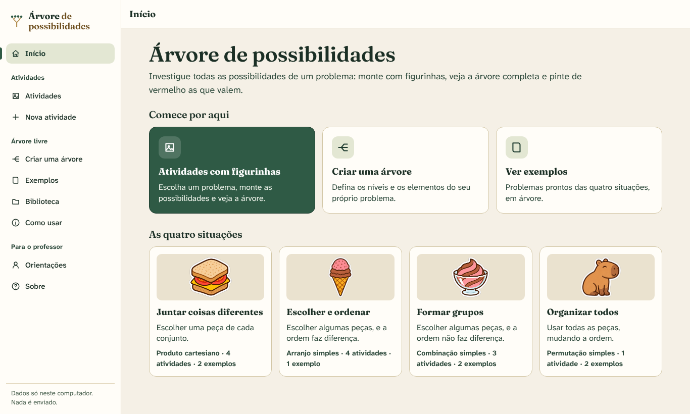
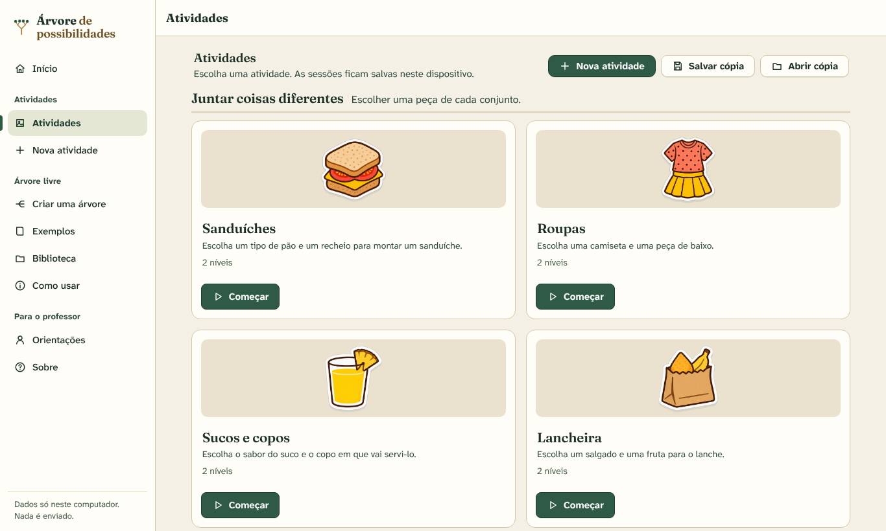
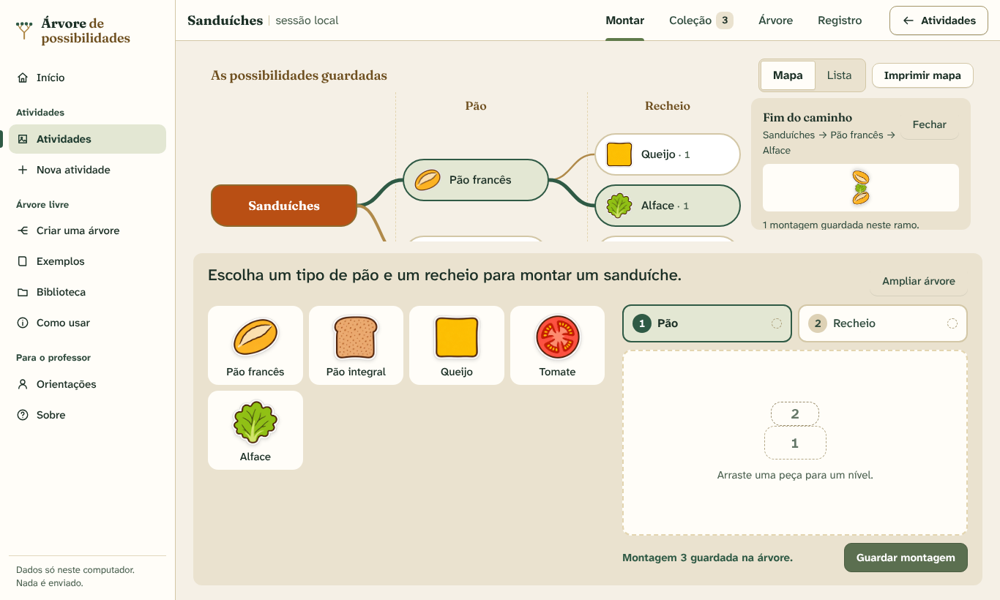
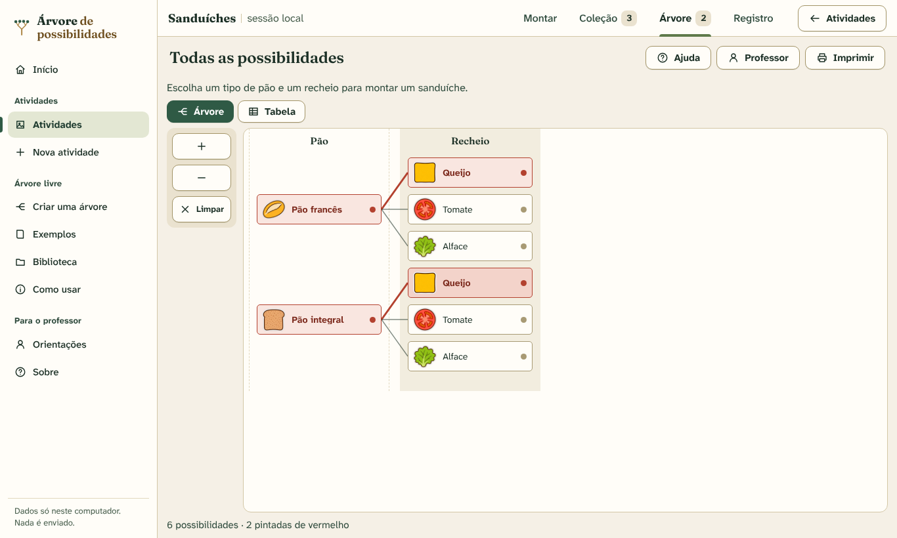
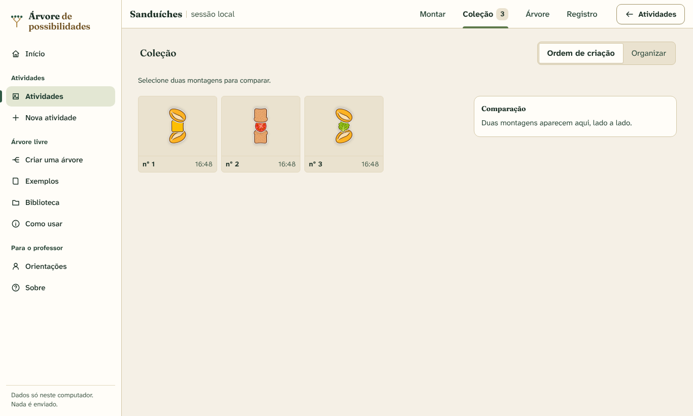
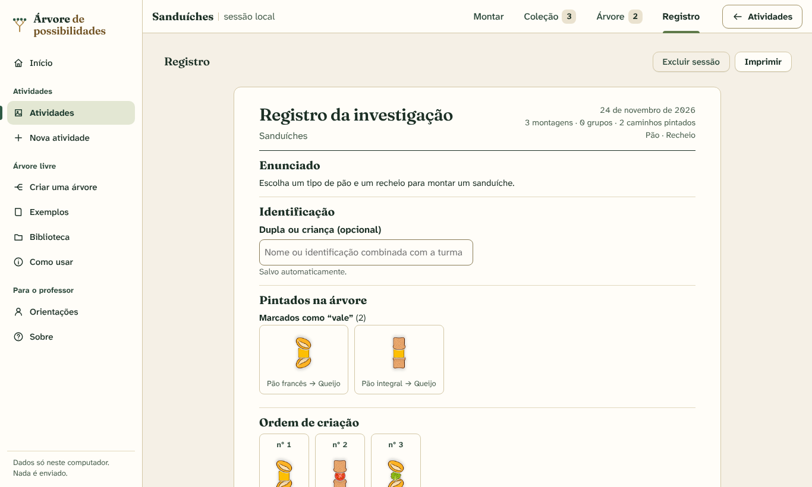
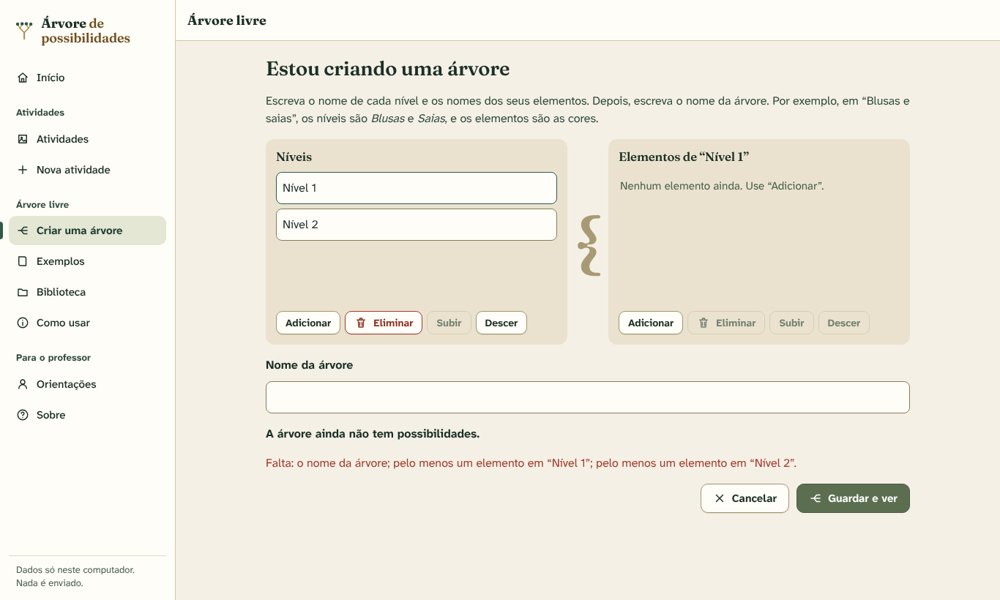
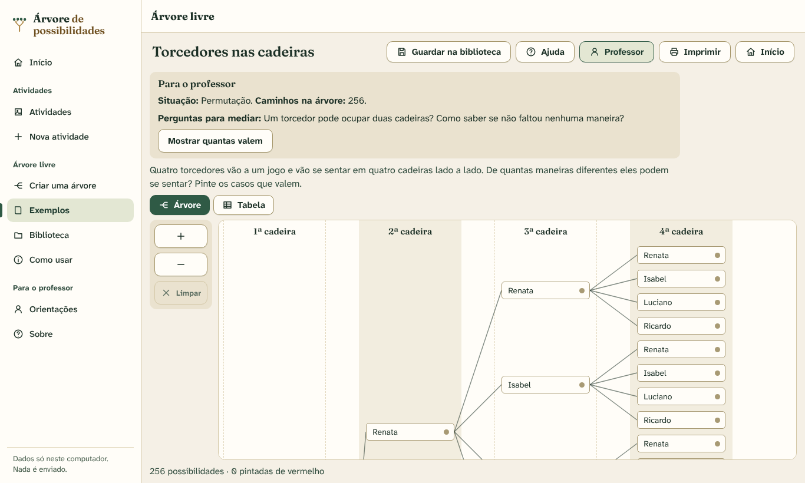
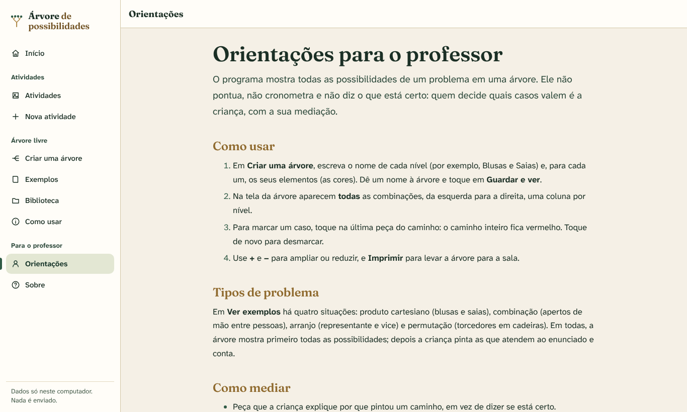

# Árvore de possibilidades

Ambiente de investigação combinatória para os anos iniciais. Une duas ideias: **montar possibilidades
com figurinhas** e **ver a árvore completa do problema**, como no Árbol (Aguirre, 2005; Azevedo, Costa e
Borba, 2011), pintando de vermelho as que valem. Aplicativo desktop em Tauri (React, TypeScript) e versão web.
Sem pontuação, cronômetro ou classificação, e sem enviar dados: tudo fica no computador.



## As quatro situações

Atividades e exemplos são organizados por situação, com nomes do dia a dia para a criança e os nomes formais
para o professor: **juntar coisas diferentes** (produto cartesiano), **escolher e ordenar** (arranjo simples),
**formar grupos** (combinação simples) e **organizar todos** (permutação simples).



## Uma atividade, em quatro etapas

Cada sessão tem quatro etapas, em qualquer ordem:

1. **Montar**: a criança arrasta as figurinhas para os níveis e guarda cada montagem; a árvore cresce com o que
   foi guardado, sem dizer se faltam casos.
2. **Coleção**: compara montagens (“é a mesma ou são diferentes?”) e cria grupos com nome.
3. **Árvore**: a árvore completa, com todas as combinações e as figurinhas; tocar no último elemento de um
   caminho pinta o caminho inteiro de vermelho. Há também a visão em tabela e o botão **Professor** (ficha
   fechada com a regra, perguntas de mediação e quantos caminhos valem, só se pedir).
4. **Registro**: nome da dupla, montagens, caminhos pintados, explicação e mediações do professor; imprimível.

| Montar | Árvore |
|---|---|
|  |  |

| Coleção | Registro |
|---|---|
|  |  |

## Árvore livre

Fora das atividades, o menu **Árvore livre** segue o Árbol: **Criar uma árvore** (níveis e elementos, até 6
níveis, 12 elementos por nível e 2000 possibilidades), **Exemplos** das quatro situações, **Biblioteca** de
árvores guardadas (com arquivo para levar a outro computador) e **Como usar**.

| Criar | Exemplo com ficha do professor |
|---|---|
|  |  |

## Para o professor

**Orientações** (uso, mediação, ficha e registro), **Nova atividade** (editor com níveis, peças e regras, e um
banco de figuras extras) e **Salvar cópia / Abrir cópia** das sessões.



## Rodar

```bash
npm install
npm run dev      # interface no navegador, porta 1420
npm test         # regras e totais das doze atividades (Vitest)
npm run app      # aplicativo Tauri em modo desenvolvimento
npm run app:build  # pacote .app/.dmg para macOS
```

Requisitos: Node 20+, Rust 1.77+ e as ferramentas de linha de comando do Xcode.

O build de produção gera:

- `src-tauri/target/release/bundle/macos/Árvore de possibilidades.app`
- `src-tauri/target/release/bundle/dmg/Árvore de possibilidades_0.1.0_aarch64.dmg`

O pacote é local e não notarizado; em outro Mac, o Gatekeeper pede confirmação
para abrir.

## Estrutura

```
src/
  data/         atividades.json, activities.ts (catálogo), situacoes.ts (quatro situações),
                exemplos-arbol.ts (exemplos da árvore livre)
  engine/       comb.ts (regras e chaves das atividades), arbol.ts (árvore completa e diagramação),
                tree.ts (árvore das montagens)
  state/        store.ts (sessões), arvores.ts (biblioteca da árvore livre)
  components/   Montagem, Icone, LogoArvore
  views/        Painel, Inicio, Mesa, Colecao, ArvoreCompleta, Registro, Editor, Orientacoes, Sobre
  views/arbol/  Criar, Ver, Lista (exemplos e biblioteca), Instruções
  styles/       tokens.css, app.css, identidade.css, arbol.css, programa.css (casca e botões)
public/atividades/   60 PNGs, em dez pastas
src-tauri/           casca Tauri 2 (Rust)
```

## Limites conhecidos

- A impressão usa o diálogo do sistema; a folha de estilo de impressão esconde
  navegação e controles.
- No aplicativo Tauri, exportar e importar usam o diálogo nativo do macOS e um
  comando Rust que grava/lê o caminho escolhido. No navegador, a exportação cai
  no download e a importação na seleção de arquivo.
- Não há telemetria, pontuação, cronômetro ou classificação — por decisão de
  projeto.
